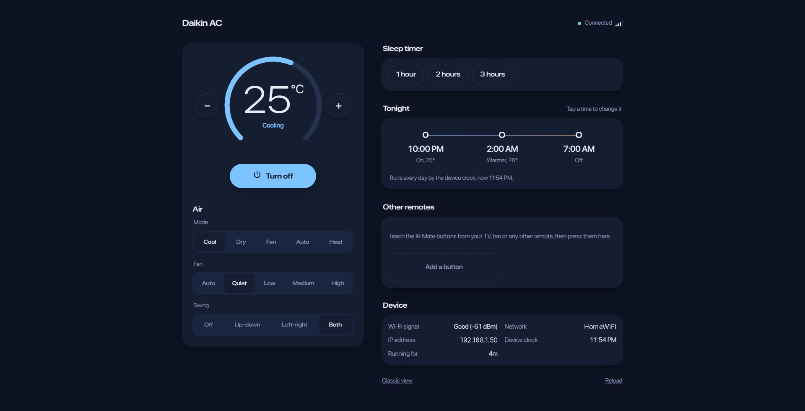
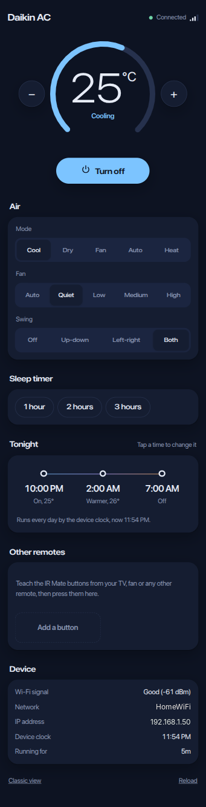
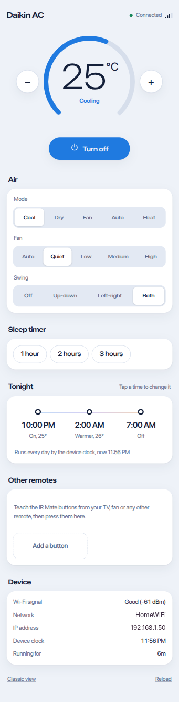
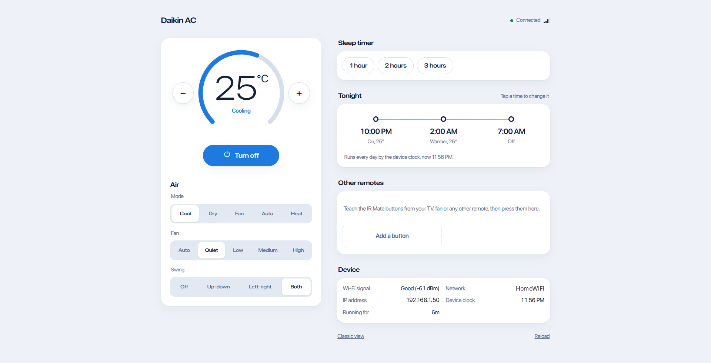

<p align="center">
  
</p>
<h1 align="center">XIAO IR Mate AC Scheduler</h1>
<p align="center">
  <strong>Turns a Seeed XIAO Smart IR Mate into a standalone AC remote that switches your air conditioner on at night, warms it after midnight and turns it off in the morning.</strong>
  <br>ESPHome firmware with a built-in web app. No Home Assistant, no cloud, no phone app.
</p>
<p align="center">
  
  
  
  
</p>

## Why

Seeed's IR Mate is a neat little infrared blaster, but its stock firmware expects Home Assistant
to do anything on a schedule. I wanted my bedroom AC on at 10 PM, a degree warmer at 2 AM and off
at 7 AM without running a server. This firmware puts the schedule, the clock and a full remote
control page on the device itself, so it keeps working with the laptop off and even without internet.

## Screenshots

<table>
  <tr>
    <td><br><sub>On a phone: AC remote, sleep timer, tonight's schedule, other remotes</sub></td>
    <td><br><sub>Follows the phone's light or dark theme</sub></td>
  </tr>
  <tr>
    <td colspan="2"><br><sub>Two-column layout on wider screens</sub></td>
  </tr>
</table>

## Features

### Schedule
- **Nightly on, warmer, off**: three steps with their own time, temperature and on/off switch
- **Runs on the device clock**: synced over the internet (SNTP), kept through Wi-Fi outages
- **Sleep timer**: turn the AC off in 1, 2 or 3 hours

### Control
- **Full AC remote**: power, temperature, mode, fan speed and swing, built from your AC brand's protocol
- **Touch to toggle**: tap the top of the IR Mate to switch the AC on or off
- **Other remotes**: teach up to 10 named buttons from a TV, fan or set-top box remote

### Web app
- **Built into the firmware**: open the device's IP in any browser, no install, works offline
- **Phone and desktop layouts**, light and dark themes, live updates
- **Classic view**: the stock ESPHome page is one link away (needs internet)

### Security
- Encrypted API, own OTA password, password-protected web page and hotspot
- Every credential lives in a gitignored `secrets.yaml`

### What it doesn't have (by design)
- **No Home Assistant requirement**: the API is still there if you want to add it later
- **No room temperature sensing**: the IR Mate has no sensor
- **No state feedback from the AC**: infrared is one-way, so the page shows what was last sent

## Supported Air Conditioners

Any brand with an ESPHome IR climate driver. Set `ac_platform` in `ir-mate.yaml`:

| `ac_platform` | Notes |
|---|---|
| `daikin` | Daikin ARC43xxx remotes. **Tested** with ARC433A55. |
| `daikin_arc`, `daikin_brc` | Other Daikin remote families |
| `gree`, `midea_ir`, `mitsubishi`, `coolix`, `toshiba`, `fujitsu_general`, `climate_ir_lg`, `whirlpool` | Untested here |
| `hitachi_ac344`, `hitachi_ac424`, `tcl112`, `ballu`, `delonghi`, `emmeti`, `noblex`, `whynter`, `zhlt01` | Untested here |
| `heatpumpir` | Library covering many more brands; untested here |

Which driver matches your remote is listed in
[ESPHome IR Remote Climate](https://esphome.io/components/climate/climate_ir/).
Fan speeds, swing and modes in the web app adapt to what the driver supports.

## Requirements

| Component | What You Need |
|---|---|
| Device | [Seeed XIAO Smart IR Mate](https://wiki.seeedstudio.com/XIAO_IR_Mate_Smart_IR_Remote/) (XIAO ESP32-C3) |
| Network | 2.4 GHz Wi-Fi |
| Computer | Python 3.12 with ESPHome 2026.10, USB-C data cable for the first flash |
| AC | An infrared-controlled AC with a supported driver (above) |

## Installation

```bash
git clone https://github.com/DhilipBinny/xiao-ir-mate.git
cd xiao-ir-mate
pip install "esphome==2026.10.0"     # or: uv tool install esphome
cp secrets.example.yaml secrets.yaml
```

1. **Fill in `secrets.yaml`**: Wi-Fi, passwords, and a fresh API key and OTA password (commands are in the file).
2. **Edit the settings at the top of `ir-mate.yaml`**: `ac_name`, `ac_platform`, temperature range, schedule defaults and `timezone`.
3. **Flash over USB-C** the first time (the stock firmware's OTA password differs from yours):

```bash
esphome run ir-mate.yaml        # pick the USB serial port when asked
```

If the port doesn't appear, hold the **BOOT** button on the XIAO while plugging it in.

Later updates go over Wi-Fi:

```bash
esphome run ir-mate.yaml --device 192.168.1.50 --no-logs
```

The first build downloads about 2.7 GB of ESP32 tooling; later builds take about a minute.

## Usage

1. Open `http://<device-ip>` and log in as `admin` with your `web_password`. Find the IP in your
   router's client list, and reserve it there so it never changes.
2. Point the IR Mate at the AC's front panel and press **Turn on** to check the aim.
3. Adjust tonight's times and temperatures under **Tonight**. They're saved on the device.

| Action | How |
|---|---|
| Toggle the AC | Tap the top of the IR Mate |
| Restart | Short press the reset button |
| Factory reset (clears Wi-Fi and learned buttons) | Hold the reset button 5 seconds |
| Change Wi-Fi without reflashing | Join the "XIAO Smart IR Mate" hotspot, open `192.168.4.1` |

### From the terminal

```bash
export IRMATE_HOST=192.168.1.50
alias irmate='uv run -q --python 3.12 --with aioesphomeapi --with pyyaml python -I scripts/device.py'
irmate status
irmate set-time "AC auto-off time" 07:30
irmate set-number "AC auto-on temperature" 25
irmate press "Sleep timer 2h"
```

## Limitations

- **Line of sight**: like a normal remote, the IR Mate must see the AC's receiver.
- **One-way infrared**: using the AC's own remote doesn't update the page.
- **Clock after power loss**: schedules wait until the device can reach an SNTP server again.
- **Learning long AC signals**: the ESP32-C3 receiver captures about 384 pulses, so AC remotes
  (often 500+) can't be learned. That's why the AC uses a protocol driver; learning is for short remotes.

## Tech Stack

- **Firmware**: ESPHome 2026.10 (ESP-IDF), ESP32-C3
- **AC control**: ESPHome `climate_ir` drivers
- **IR learning**: Seeed's `Flash_comp` component (pinned commit), raw signals stored in NVS
- **Web app**: vanilla JavaScript and CSS, embedded via `web_server` `js_include`; ESPHome REST API and Server-Sent Events
- **CI**: GitHub Actions validates the config and the web app on every push

## Project Structure

```
ir-mate.yaml              # Your settings: AC brand, temperatures, schedule defaults, timezone
packages/
├── seeed_base.yaml       # Hardware, IR learning, touch pad, LED (derived from Seeed's firmware)
├── network.yaml          # Wi-Fi, encrypted API, OTA, clock, diagnostics
├── ac.yaml               # AC climate driver and sleep timer
├── schedule.yaml         # Nightly on / warmer / off
├── remotes.yaml          # Named buttons for other remotes
└── web.yaml              # Embeds the web app
web/
├── app.js                # Web app logic
└── app.css               # Web app styles
scripts/device.py         # Read or change settings over the API
secrets.example.yaml      # Template for secrets.yaml
```

## Contributing

1. Fork the repo and create a branch
2. Make your change; run `esphome config ir-mate.yaml` and `node --check web/app.js`
3. Commit with a clear message
4. Open a pull request. Reports of other AC brands working (or not) are especially welcome.

## License

GPL-3.0. See [LICENSE](LICENSE) for details. `packages/seeed_base.yaml` is derived from
[Seeed Studio's xiao-esphome-projects](https://github.com/Seeed-Studio/xiao-esphome-projects), also GPL-3.0.

<p align="center"><sub>Built so the AC is off before the alarm goes off.</sub></p>
